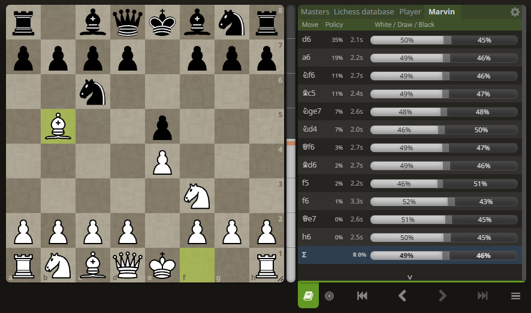

# Marvin Opening Explorer

A Chrome / Edge extension that adds a **Marvin** tab to the Lichess opening
explorer. It shows how human players at a chosen rating and time control are
likely to move, using the [Marvin](https://huggingface.co/holymolyyy/marvin-onnx)
model running locally on your PC.



- **Policy**: how likely each legal move is to be played.
- **White / Draw / Black**: the predicted result after each move. **Σ** is the
  policy-weighted total.
- **Think time**: hover the clock next to a move to see its time distribution.
- Filters for rating (1200–2500) and time control, via the gear button.
- Works on the analysis board, finished games and studies.

Nothing is sent to any server: the model runs on your machine through Chrome's
native messaging.

## Install (Windows)

1. Install Python 3.11+ and the dependencies:

   ```powershell
   python -m pip install -r host\requirements.txt
   ```

   For an NVIDIA GPU, install `onnxruntime-gpu` instead of `onnxruntime`.

2. Download `marvin_79m.onnx`, `marvin_23m.onnx` and their `.offset.npz` files
   from [holymolyyy/marvin-onnx](https://huggingface.co/holymolyyy/marvin-onnx)
   into a `weights` folder in this project.

3. Register the local model host for Chrome and Edge:

   ```powershell
   .\install.ps1
   ```

4. Open `chrome://extensions` (or `edge://extensions`), turn on **Developer
   mode**, click **Load unpacked** and select the `extension` folder.

5. Open an [analysis board](https://lichess.org/analysis), open the opening
   explorer (book button) and select the **Marvin** tab.

The toolbar icon chooses the model (79M or the faster 23M) and display options.
To remove the host, run `.\install.ps1 -Uninstall`, then remove the extension
in the browser.

## Development

```powershell
python -m unittest discover -s tests -p "test_*.py"
node --test tests/
```
